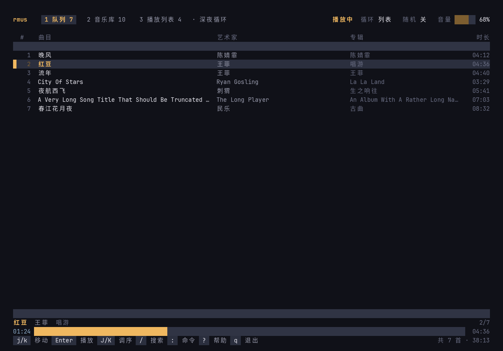

# rmus

Client/server terminal music player: `rmusd` daemon (audio engine) + `rmus` client.

Close your terminal — the music keeps playing.

## Features

- Daemon/client split: the daemon owns playback, clients come and go
- FLAC / MP3 / OGG / WAV / M4A decoding (symphonia), resampled to your device (rubato)
- MPRIS: desktop media keys, player widgets, cover art, lyrics
- Music library with search, auto-updated as files change
- Named playlists, repeat / shuffle, state persists across restarts
- Multi-client NDJSON protocol over a Unix socket

## Build

```
cargo install --path . --locked
```

## Usage

The daemon is auto-spawned on first use, so `rmus` alone is enough:

```
rmus ~/Music/song.flac     # play files or directories (replaces the queue)
rmus ~/Music/              # queue up a whole directory
rmus toggle                # play / pause
rmus next                  # next / previous
rmus volume 70             # absolute, or relative like +10
rmus status
rmus queue                 # show the queue
rmus seek 1:23             # or +10 / -10 for relative
rmus dl <keyword> -g 1,3   # online search / download via a plugin (see Plugins)
rmus quit                  # stop the daemon
```

## TUI

Run `rmus` with no subcommand to open the interactive player:



- Top bar: view tabs with counts, current queue name, playback state, repeat / shuffle / volume
- Queue: one row per track — number, title, artist, album, duration — with the playing track marked
  by an accent bar and the selection by a raised row; long titles truncate with an ellipsis
- Library: everything indexed from `~/Music`; `Enter` jump-plays a track, `a` appends it to the
  queue without interrupting playback
- Playlists: the active playlist carries a `当前` badge
- Bottom: now-playing title line plus a full-width progress bar (elapsed / total)
- `/` fuzzy library search, `:` command palette, `?` scrollable help sheet, `w` save the queue
- The layout collapses gracefully as the window narrows: album column, then artist column, then
  the secondary status readouts drop out; the terminal title follows the current track

### Editing the queue

- Vim motions: `j`/`k` move, `gg`/`G`/`0` jump to top / bottom, `C-d`/`C-u` scroll half pages,
  `gt` / `gT` switch views (`2gt` jumps to view 2); digits `1-4` also switch views directly
- `v` starts visual selection in the queue / library / playlists: `d` / `x` cut the selection,
  `y` yanks it, `o` swaps the selection ends, `Esc` / `v` leave visual mode
- `m` marks the selected row for gapped multi-select (ranger-style); `d` / `y` harvest all marked
  rows, `M` clears the marks — marks are keyed by path, so reordering doesn't break them
- `dd` cuts the selected track (queue and playlists) into the register, nvim-style: `dj` / `dk` /
  `dG` / `dgg` cut down / up / to the end / to the top, all undoable in one step; `x` / `D` (remove
  the playing track) also fill the register
- `yy` yanks the selected track (queue or library) into the register; `p` / `P` put it after /
  before the queue cursor, so `dd` + `p` moves a track
- `u` undoes the last queue change (delete, clear, shuffle, reorder, insert), `C-r` redoes
- `J` / `K` move the selected track down / up inside the queue; the cursor follows the track
- `D` / `x` remove the playing one, `C` clears, `S` shuffles
- `c` renames the current queue (an anonymous queue gets its first name; a named one keeps its
  history under the new name)
- `gd` locates the selected queue track in the library view
- In the search overlay: `Esc` toggles between input and a vim-like normal mode. In normal mode
  `j`/`k` move, `gg`/`G` jump, `Enter` jump-plays, `o` plays it after the current track, `a`
  appends to the end of the queue, `gf` locates the track in the library view, `i` or `/` returns
  to the query; in input mode the same actions live on `Enter` / `C-o` / `Tab` / `C-g`, with
  `C-u` clearing the query and `C-w` deleting the last word
- `[` / `]` seek 10 seconds back / forward
- In the playlists view, `c` renames and `d` deletes the selected playlist

While an overlay is open the terminal cursor moves into its input line; everywhere else it is hidden.

### Theme

One palette — ink-blue surfaces with a warm amber "listening lamp" accent, steel blue for secondary
metadata. Colors are authored in RGB and quantized to xterm-256 when the terminal is not known to
support 24-bit color.

| Variable | Effect |
| --- | --- |
| `RMUS_COLOR=truecolor` | Force 24-bit color |
| `RMUS_COLOR=256` | Force the 256-color approximation |
| `NO_COLOR=1` | Monochrome: hierarchy moves to reverse video, rules and bars to glyphs |

## Plugins

rmusd hosts plugins: either wasm32 modules (wasmi, capabilities proxied by the
host) or out-of-process executables speaking a small NDJSON protocol over
stdio. The player itself stays capability-agnostic — it knows nothing about
what a plugin does.

- Discovery: `$XDG_DATA_HOME/rmus/plugins/*` (default `~/.local/share/rmus/plugins`),
  `~/.config/rmus/plugins/*`, `$XDG_DATA_DIRS/*/rmus/plugins`; override with
  `RMUS_PLUGIN_DIR` (colon-separated)
- wasm plugins are handshaked in-process (manifest export); executables via
  `--rmus-manifest`, then spawned long-lived as `--rmus-plugin` on first use;
  sessions idle out after 10 minutes
- Calls the manifest marks as `task` return a job number immediately and stream
  progress to every client as `Event::Plugin`; `call` methods block up to 30s

Plugins live in [rmus-plugins](https://github.com/mengh04/rmus-plugins):
`rmus-dl` (online search + download via kuwo / kugou) and `rmus-podcast` (RSS
subscriptions and episode playback). Build them there and drop the `.wasm`
into the plugins directory, then restart `rmusd`:

```
cargo build --release --target wasm32-unknown-unknown
mkdir -p ~/.local/share/rmus/plugins
cp target/wasm32-unknown-unknown/release/rmus_dl.wasm ~/.local/share/rmus/plugins/rmus-dl.wasm
```

Then the TUI grows an `在线` tab: `/` searches, `d` downloads (progress in the
duration column), `Enter` downloads and peek-plays when done, `x` cancels.
Finished files are written straight into `~/Music` with full tags, where the
library watcher picks them up automatically. Wire protocol details:
[docs/plugins.md](docs/plugins.md).

Detailed documentation is coming later.

## Layout

One file, one job — if a file needs a table of contents, it gets split. Every module below has a
single responsibility and a doc comment explaining it.

```
src/
  proto.rs              wire protocol (NDJSON)
  plugin.rs             plugin contract: discovery, manifest, session wire format
  engine/               audio engine (single thread, owns queue + device)
    mod.rs              Engine state, spawn, status
    run.rs              event loop (commands, decoder reports, position pushes)
    handlers.rs         request dispatch
    playback.rs         play / pause / stop / next / prev / seek / volume
    track.rs            decoder thread lifecycle (incl. play-now)
    peek.rs             preview state: snapshot + restore
    decoder.rs output.rs queue.rs resample.rs store.rs
  daemon/               rmusd
    main.rs             startup wiring (engine, MPRIS, library, socket)
    conn.rs             one client connection (writer task, event fan-out)
    dispatch.rs         routing: library queries, scans, plugin calls, engine commands
    plugin_host.rs      plugin host: discovery, sessions, call forwarding
    reply.rs            NDJSON reply encoding
    watch.rs            library directory watcher
    mpris/              desktop integration (art, metadata, events, root/player interfaces)
  client/
    main.rs             CLI argument types
    cli/                subcommand dispatch, output, argument parsing
    tui/                the interactive player
      app/              state + actions, one file per input mode
      cmd/              `:` command table and parser
      keymap.rs         Normal-mode key table (single source of truth)
      ui/               rendering: theme, widgets, views, overlays
```

## License

MIT
